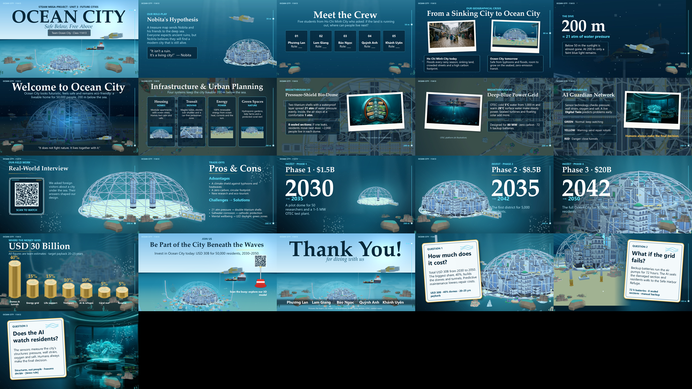

# Ocean City – Final Pitch

STEAM Mega-Project · Unit 3 Future Cities · Team Ocean City, Class 11A13

**Xem trình chiếu:** https://eco-polis.github.io/ocean-city-pitch/

- Phím → hoặc Space để sang slide, F để toàn màn hình, thêm `?auto=6` vào link để tự chạy.
- File PowerPoint: [Ocean-City-Pitch.pptx](Ocean-City-Pitch.pptx). Hiệu ứng Morph cần PowerPoint 2019 hoặc 365.
- Mô hình 3D: https://eco-polis.github.io/aquapolis-3d-vn/

Hình ảnh: render từ mô hình 3D của nhóm và một số ảnh minh họa tạo bằng AI (phố ngập, mặt cắt mái vòm, trạm OTEC, phòng điều khiển). Số liệu là ước tính của nhóm.
